# Electric Motor Winding Temperature Estimation and Thermal Monitoring Using Machine Learning

**UCS321 · MST Mini Project #6 · General Electric (GE) Power Systems case study**
Author: [your name / roll number] · Results mode: **full (final results)** · Config hash `b77edc0501dd` · Seed 42

> *Provenance of numbers.* Every number in this report is generated by `uv run motor-thermal report` from the
> files in `artifacts/full/` (produced by real training and evaluation runs on the measured data).
> The GE name comes from the assignment; the data are from a Paderborn University test bench, not GE equipment.

---

## 1. Abstract

Knowing the temperature of a motor's stator winding is essential for protecting insulation and for using
the motor close to its thermal limit, but a sensor inside the winding is costly and fragile. This project
builds a **virtual temperature sensor** for a permanent-magnet synchronous motor (PMSM): a regression model
that estimates `stator_winding` from speed, torque, d-q currents and voltages and coolant/ambient
temperature - **without ever seeing any measured internal motor temperature as an input**. We use the public
Paderborn University LEA test-bench recordings (1,330,816 samples at an assumed 2 Hz, ≈ 185 h, 69
operating profiles) and evaluate exclusively on **whole operating profiles that were held out** from
training, tuning and model selection (49 / 10 / 10 train / validation / test profiles).

Two model tracks are compared: an *instantaneous* estimator (current measurements only) and a
*history-aware* estimator that adds strictly causal exponentially weighted and rolling averages of load and
coolant temperature to represent thermal inertia. On the 10 unseen test profiles the best
instantaneous model reaches **MAE 9.53 °C** (R² 0.795), while the history-aware LightGBM reaches
**MAE 2.35 °C** (RMSE 3.37 °C, R² 0.987, 95 % of errors below 6.43 °C) - 4.0× lower
error. The worst test profile still has an MAE of 3.16 °C, and accuracy degrades in the first minutes
of a profile and after a history-buffer restart on a warm motor. A residual (measured − estimated)
monitor with a validation-calibrated band is demonstrated as an *experimental* indicator only. A Streamlit
dashboard, automated tests (62 tests), a report and a presentation accompany the code.

---

## 2. Problem definition

**Task.** Supervised regression. Given operational measurements at time *t* (and, for Track B, their causal
history), estimate the current stator-winding temperature $\hat y_t$ in °C.

**Central question.** Can an ML virtual sensor estimate winding temperature accurately on previously unseen
operating profiles, without access to that winding temperature at inference time?

**Objectives.** (1) a leakage-safe, profile-wise validated regression system; (2) comparison of baselines
and algorithms; (3) physics-informed, thermal-history-aware features and an honest ablation; (4) evaluation
beyond a single score (per profile, per temperature range, per operating region, per time in profile);
(5) explainability; (6) a bounded residual-monitoring demonstration; (7) a usable application and
reproducible pipeline.

**Non-goals.** Certified motor protection; fault-detection claims (no labelled faults exist); claims about any
motor other than the one on this test bench.

---

## 3. Industry motivation: direct sensing vs. virtual sensing

| Aspect | Direct sensor in the winding | Virtual (ML) sensor |
|---|---|---|
| Accuracy on the quantity itself | Highest when healthy and calibrated | Statistical; typical error 2.35 °C here, larger on unusual profiles |
| Hardware / cost / wiring | Extra part, insulation-safe routing, assembly cost | None - reuses existing signals |
| Failure modes | Sensor drift or loss; hard to replace once potted | Model error outside training domain; depends on other sensors |
| Dynamics | Measures real state instantly | Needs history to capture thermal inertia |
| Redundancy | Single point | Can cross-check a physical sensor (residual monitoring) or replace it |
| Validation burden | Calibration | Needs representative training data and continuous plausibility checks |

Motivation: thermal derating strategies in traction and power-generation drives limit torque by estimated
winding temperature; a good estimate allows more continuous power from the same hardware while protecting
insulation. Virtual sensing is attractive as a redundant channel and where sensors are impractical.

---

## 4. PMSM and winding-heating fundamentals

**d-q quantities.** The Park transform expresses the three-phase currents in a frame fixed to the rotor.
`i_d` acts along the magnet flux (negative values weaken the field at high speed); `i_q` produces most of the
torque (in this data, corr(`torque`, `i_q`) = 0.997). Current magnitude is
$|i| = \sqrt{i_d^2 + i_q^2}$.

**Heat sources.** Copper loss $P_{Cu} \approx 1.5\,R(T)\,(i_d^2+i_q^2)$ (amplitude-invariant convention; resistance
grows with temperature); iron loss (grows with speed/flux); friction and windage (speed). Heat flows through
resistances to the coolant.

**Thermal inertia.** A lumped thermal node with capacity $C$, resistance $R$ to the coolant and heating $P$:

$$C\,\frac{dT}{dt} = P(t) - \frac{T - T_{cool}}{R}, \qquad \tau = RC$$

Discretised with time step $\Delta t$ (0.5 s):

$$T_{k+1} = (1-\alpha)\,T_k + \alpha\,(T_{cool,k} + R\,P_k), \qquad \alpha = \Delta t/\tau$$

i.e. the temperature is an **exponentially weighted moving average** of the heating history. The same
instantaneous currents may therefore correspond to very different temperatures. This is the physical
motivation for the history-aware track. A real motor has several coupled thermal masses with different
$\tau$ (seconds to hours), hence several EWMA time constants.

---

## 5. Dataset source and provenance

| Item | Value |
|---|---|
| Source | <https://www.kaggle.com/datasets/wkirgsn/electric-motor-temperature> |
| Origin | Paderborn University LEA motor test bench (Kirchgässner, Wallscheid, Böcker) |
| Licence | **CC BY-SA 4.0** as stated in the assignment brief (attribution, share-alike) - *not independently verified by this project; check the Kaggle page*; raw data are not stored in this repository |
| File | `measures_v2.csv`, 300 MB, SHA-256 `78f3d150f0f2ad9c5dc7ff24dd12c00d386ad530f48c1589ad24fcd88867d3ad` |
| Download | `kagglehub` (anonymous access worked); manual `--csv` fallback implemented |
| Rows × columns | 1,330,816 × 13 (`u_q, coolant, stator_winding, u_d, stator_tooth, motor_speed, i_d, i_q, pm, stator_yoke, ambient, torque, profile_id`) |
| Operating profiles | 69 (`profile_id`), 2,176-43,971 rows each (median 2.4 h) |
| Sampling | 2 Hz **as documented by the authors**; the file has no timestamp column |
| Units | not shipped; plausible from value ranges: °C, rpm, N·m, A, V (all signals appear to be in physical units, not standardised) |

**Chronology.** There are no timestamps. We verified that every `profile_id` is **one contiguous block** of
rows (69 blocks for 69 profiles), so within-profile row order is used as time. Per-sample
winding-temperature steps are smooth (median 0.022 °C, 99.9th percentile 0.55 °C), which is
consistent with - but does not prove - a 2 Hz series.

**Dataset check (brief, search-result level).** A short web search for public alternatives found: a small Zenodo
inverter-driven PMSM set (8 raw signals at 10 Hz, fault scenarios, thermistor calibration - small scale, no comparable
measured winding-temperature label identified), an IEEE DataPort inter-turn-short-circuit set (electrical signals, no
temperatures), a TU Graz CREATOR machine-design set (parameters, not operating measurements) and a PMSG condition-monitoring
benchmark (electrical signals). None offers comparable scale, operating diversity and a measured winding-temperature label, so the
Paderborn set was kept. Unrelated fault datasets were not merged. This was a brief check, not a systematic survey.

**Limitations of the data.** One motor on one test bench; profiles are generated by the test-bench operators
(including the coolant temperature, which is a controlled variable); temperature sensors have unknown
uncertainty and placement; 22 of 69 profiles start with a warm motor.

---

## 6. EDA and preprocessing

* **Missing values:** 0. **Duplicate rows:** 0. No imputation is needed.
* **Constant readings:** 336 runs of ≥ 10 s of an identical winding reading (32896 samples);
  13.6 % of rows have |speed| < 1 rpm. These are legitimate idle/standstill phases and were **kept**.
* **Plausibility:** all columns lie inside the physically plausible ranges in `configs/default.yaml` (no warnings). Winding temperature spans 19-141 °C; coolant 11-102 °C;
  ambient 9-31 °C.
* **Start state:** 47 profiles start within 5 K of ambient, 22 start warmer (up to 99 °C).
  A history buffer that starts empty on a warm motor is therefore a realistic situation, not an edge case.
* **Correlations (training profiles):** corr(winding, tooth) = 0.97, corr(winding, yoke) = 0.87,
  corr(winding, magnet) = 0.79: the other measured temperatures are almost collinear with the target,
  which is why they are **forbidden as inputs**. Instantaneous $i^2$ correlates only 0.49 with winding temperature.
* **Preprocessing:** float32 storage, no row deletion, no resampling of the raw series; derived features computed at the native rate;
  scaling only inside model pipelines, fitted on training rows.

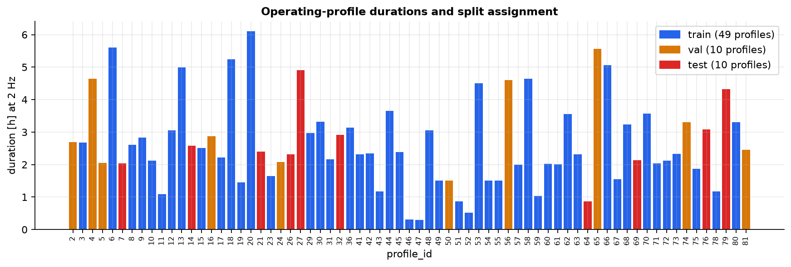
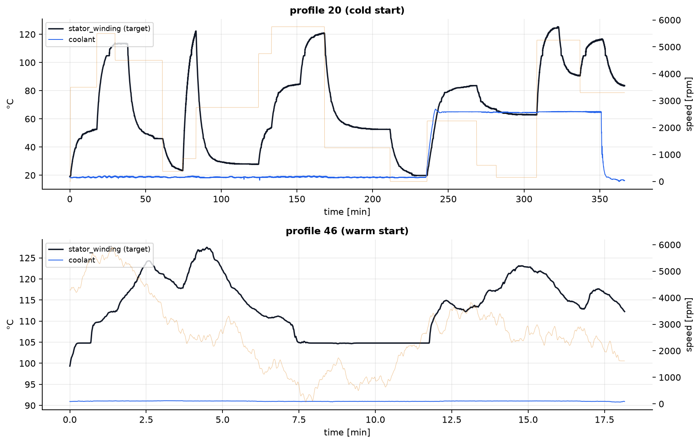
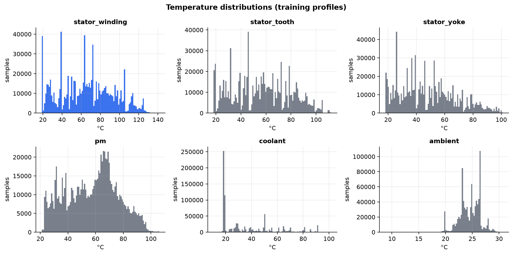
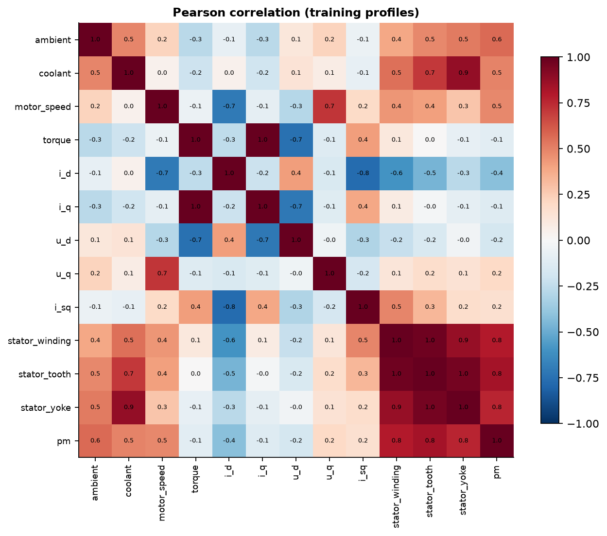
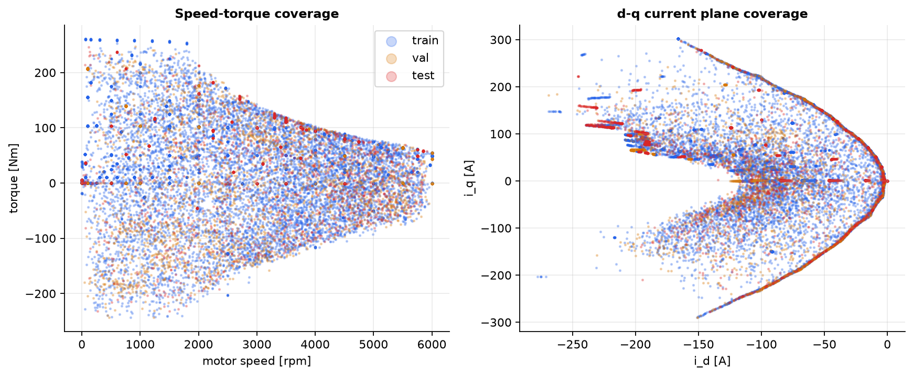
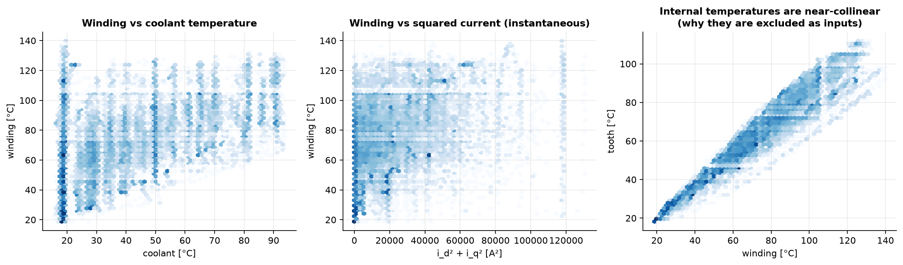

*EDA statistics that could steer modelling (correlations, distributions) use training profiles only; the
coverage plot shows where validation/test profiles lie relative to training.*

---

## 7. System architecture

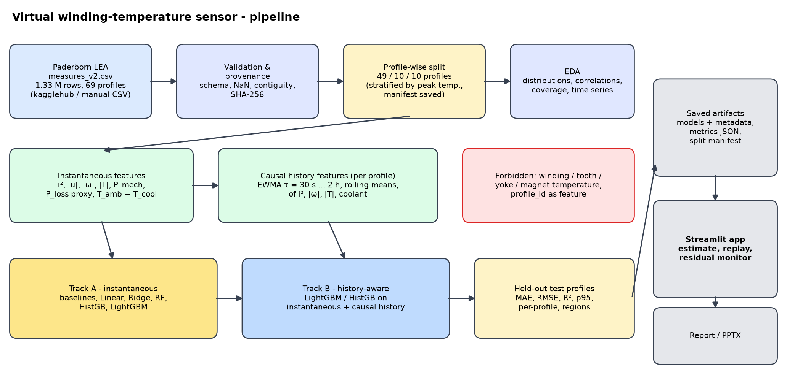

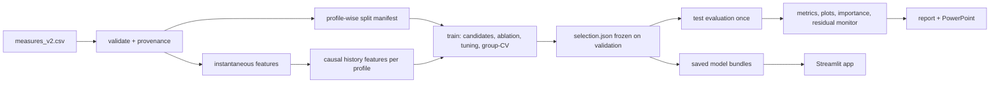

---

## 8. Mathematical explanation of the models

**Linear / Ridge regression.** $\hat y = w^\top x + b$. Ordinary least squares minimises
$\frac1n\sum_i (y_i-\hat y_i)^2$ with solution $w = (X^\top X)^{-1}X^\top y$. Ridge adds $\lambda\lVert w\rVert^2$,
stabilising correlated features. Features are standardised inside a `Pipeline` (statistics from training rows only).

**Decision tree / Random Forest.** A regression tree recursively splits on the feature and threshold that most
reduces the squared error; each leaf predicts its training mean. A forest averages many trees grown on bootstrap
samples and random feature subsets, reducing variance. Trees cannot extrapolate beyond the training range.

**Gradient boosting (HistGradientBoosting, LightGBM).** Additive model
$F_M(x) = F_0 + \eta\sum_{m=1}^{M} h_m(x)$, where each tree $h_m$ fits the negative gradient of the loss -
for squared error simply the residuals $r_i = y_i - F_{m-1}(x_i)$. $\eta$ is the learning rate. LightGBM
discretises features into histograms (fast split search), grows trees leaf-wise (`num_leaves` controls
complexity) and treats NaN natively by learning a default direction at every split.
**Early stopping** halts adding trees when the validation MAE has not improved for 100 rounds.

**Why not deep learning?** The data are tabular, the history features already encode the dynamics, boosted
trees train in seconds on a CPU, are small (857 kB for the Track B model) and predict in
≈ 3.5 ms per sample. No evidence suggested that the extra cost of a neural network would be justified
within this project's scope.

---

## 9. Feature engineering and thermal inertia

| Feature | Kind |
|---|---|
| `i_sq` | exact: |i|^2 = i_d^2 + i_q^2 (copper-loss driver; amplitude convention unknown) |
| `i_mag` | exact: sqrt(i_d^2 + i_q^2) |
| `u_mag` | exact: sqrt(u_d^2 + u_q^2) |
| `abs_speed` | exact: |motor_speed| |
| `abs_torque` | exact: |torque| |
| `p_mech_w` | exact if torque [Nm] and speed [rpm]: torque * speed * 2*pi/60 |
| `p_elec_proxy` | proxy: 1.5*(u_d*i_d + u_q*i_q); factor assumes amplitude-invariant dq |
| `p_loss_proxy` | proxy: p_elec_proxy - p_mech_w (total loss estimate, ~copper+iron+friction) |
| `ambient_minus_coolant` | exact: ambient - coolant [K] |

**History features (Track B).** For each of the signals $s \in \{i^2, |\omega|, |T|, T_{cool}\}$ we compute

$$\mathrm{EWMA}_\tau(s)_k=\frac{\sum_{j\le k}(1-\alpha)^{k-j}s_j}{\sum_{j\le k}(1-\alpha)^{k-j}},\quad \alpha=1-e^{-\Delta t/\tau},\ \tau\in\{30,120,600,1800,7200\}\ \text{s}$$

and rolling means over 60 s and 300 s. Windows are given in seconds and converted using the sampling rate. Together with the 17
instantaneous features this gives 45 inputs. Properties verified by tests:

* **Causality** - changing future samples does not change earlier feature values.
* **Profile boundaries** - the first sample of each profile starts a fresh history.
* **Cold start** - rolling means are NaN until their window is full; EWMAs are defined from the first sample
  (normalised weights). Nothing is filled with arbitrary constants.
* **Consistency** - the streaming implementation (`StreamingHistory`) equals the vectorised one.
* **Sensor independence** - no lag or rolling statistic of any measured temperature other than the coolant/ambient inputs is used.

---

## 10. Training, validation and leakage prevention

**Split (whole profiles, deterministic, saved in `artifacts/split_manifest.json`).**

| split | profiles | rows | % of rows |
|---|---|---|---|
| train | 49 | 903,628 | 67.9 |
| val | 10 | 228,689 | 17.2 |
| test | 10 | 198,499 | 14.9 |

Profiles are sorted by peak winding temperature, cut into chunks of 7 and each chunk contributes one
validation and one test profile (seeded). Only whole profiles move between sets; peak temperature is used only
to place profiles, not samples. Test profiles: 7, 14, 21, 26, 27, 32, 64, 69, 76, 79. Validation profiles: 2, 4, 5, 16, 24, 50, 56, 65, 74, 81.

**Guards.** (1) `forbidden_features` in the config + `assert_no_forbidden` on every feature list;
(2) the split manifest asserts disjointness and completeness; (3) scalers live inside `Pipeline`s fitted on
training rows; (4) the evaluation stage refuses to run unless `selection.json` was frozen on validation
profiles; (5) 62 automated tests including leakage invariance (corrupting the measured internal
temperatures does not change predictions), causality, profile resets and streaming = offline.

**Run mode and sampling.** Mode: **full (final results)**. Training profiles used: 49 of
49; history features computed at 2 Hz *before* thinning; training rows kept every 2 samples
(effective interval 1.0 s) → 451,824 of 903,628 training rows (50.0 %).
Windows keep their physical duration. Validation and test use **all** rows of their profiles.

**Tuning.** LightGBM random search with 14 configurations per track (trial 0 = library defaults),
early stopping on the validation profiles (a mild optimism for those models on the validation score, never on
the test score); best-validation configuration selected. Group-aware 5-fold CV over train+val profiles
(`GroupKFold`) quantifies the dependence on which profiles are held out:

| candidate | MAE mean ± std [°C] | folds |
|---|---|---|
| A/lightgbm[t2]/enhanced | 9.84 ± 1.05 | [9.102, 10.17, 11.137, 8.213, 10.599] |
| B/lightgbm[t2]/enhanced+ewma_long_rolling | 2.62 ± 0.25 | [2.318, 3.08, 2.577, 2.576, 2.537] |
| A/ridge/enhanced | 10.53 ± 0.76 | [10.605, 10.262, 10.88, 9.29, 11.62] |

**Compute.** 20.7 min wall-clock, peak memory 1661 MB, 12 logical CPUs, 16.9 GB RAM,
Python 3.12.8, scikit-learn 1.9.1, LightGBM 4.7.0. No GPU used.

---

## 11. Experimental comparison and verified results

### 11.1 All candidates on the held-out test profiles

Selection was frozen on validation profiles; the test table is a single pass. `A` = instantaneous, `B` = history-aware;
`[tN]` = tuned LightGBM trial N.

| candidate | n_features | test MAE | RMSE | R² | p95 AE | profile-mean MAE | worst-profile MAE | val MAE | fit [s] | size [kB] |
|---|---|---|---|---|---|---|---|---|---|---|
| A/lightgbm[t2]/enhanced | 17 | 9.53 | 13.34 | 0.795 | 27.31 | 9.04 | 13.19 | 8.80 | 3.86 | 108.90 |
| A/lightgbm/basic | 8 | 9.55 | 13.60 | 0.787 | 29.20 | 8.97 | 13.23 | 9.42 | 2.93 | 224.00 |
| A/lightgbm/enhanced | 17 | 10.32 | 14.11 | 0.771 | 29.37 | 9.82 | 14.27 | 9.44 | 3.90 | 171.80 |
| A/hist_gb/basic | 8 | 10.55 | 14.71 | 0.750 | 30.55 | 10.04 | 15.23 | 9.90 | 8.41 | 994.90 |
| A/hist_gb/enhanced | 17 | 11.02 | 14.76 | 0.749 | 28.12 | 10.56 | 16.02 | 9.66 | 8.50 | 1011.10 |
| A/linear/enhanced | 17 | 11.65 | 15.43 | 0.725 | 30.18 | 11.53 | 18.66 | 10.58 | 0.20 | 1.40 |
| A/ridge/enhanced | 17 | 11.65 | 15.43 | 0.725 | 30.17 | 11.54 | 18.66 | 10.58 | 0.15 | 1.30 |
| A/linear/basic | 8 | 12.85 | 16.47 | 0.687 | 30.35 | 12.71 | 19.86 | 12.28 | 0.09 | 1.00 |
| A/ridge/basic | 8 | 12.85 | 16.47 | 0.687 | 30.35 | 12.71 | 19.86 | 12.28 | 0.08 | 1.00 |
| A/random_forest/basic | 8 | 13.06 | 16.63 | 0.681 | 32.07 | 12.61 | 16.37 | 12.20 | 27.40 | 101876.60 |
| A/random_forest/enhanced | 17 | 13.20 | 17.32 | 0.654 | 34.87 | 12.47 | 17.63 | 12.46 | 57.36 | 102872.60 |
| A/linear/physical | 2 | 15.17 | 20.08 | 0.535 | 39.25 | 14.69 | 24.55 | 14.30 | 0.03 | 0.80 |
| A/mean_baseline/basic | 8 | 25.20 | 29.65 | -0.013 | 54.67 | 24.61 | 42.91 | 26.59 | 0.04 | 0.50 |
| B/lightgbm[t2]/enhanced+ewma_long_rolling | 45 | 2.35 | 3.37 | 0.987 | 6.43 | 2.27 | 3.16 | 2.20 | 31.73 | 856.60 |
| B/lightgbm/enhanced+ewma_long_rolling | 45 | 2.39 | 3.74 | 0.984 | 7.76 | 2.21 | 3.66 | 2.39 | 26.69 | 1441.70 |
| B/hist_gb/enhanced+ewma_long_rolling | 45 | 2.54 | 3.89 | 0.983 | 7.78 | 2.35 | 4.35 | 2.45 | 16.56 | 1058.70 |
| B/lightgbm/enhanced+ewma_medium | 29 | 3.00 | 5.37 | 0.967 | 11.43 | 2.88 | 4.77 | 2.95 | 17.26 | 1868.00 |
| B/lightgbm/enhanced+ewma_long | 37 | 3.45 | 5.64 | 0.963 | 10.78 | 3.22 | 6.03 | 3.93 | 8.44 | 277.90 |
| B/lightgbm/enhanced+rolling_only | 25 | 3.60 | 4.89 | 0.972 | 9.59 | 3.39 | 4.55 | 3.72 | 7.64 | 420.80 |
| B/lightgbm/enhanced+ewma_short | 25 | 3.82 | 5.99 | 0.959 | 11.06 | 3.71 | 6.56 | 3.63 | 21.53 | 1853.00 |
| B/lightgbm/enhanced+ewma_long_loads_only | 32 | 5.20 | 7.91 | 0.928 | 16.46 | 4.79 | 6.87 | 5.47 | 6.35 | 200.20 |

Winners (lowest validation MAE per track): **Track A** `A/lightgbm[t2]/enhanced`, **Track B** `B/lightgbm[t2]/enhanced+ewma_long_rolling`.

### 11.2 Headline metrics

| metric | Track A | Track B |
|---|---|---|
| MAE [°C] | 9.526 | 2.355 |
| RMSE [°C] | 13.345 | 3.372 |
| R² | 0.795 | 0.987 |
| median abs. error | 6.941 | 1.732 |
| 95th pct abs. error | 27.306 | 6.430 |
| bias (est − meas) | -0.245 | 0.245 |
| profile-mean MAE | 9.040 | 2.273 |
| median-profile MAE | 9.769 | 2.344 |
| worst-profile MAE | 13.190 | 3.160 |

*Sample-weighted* metrics let long profiles dominate; *profile-level* metrics weight every profile equally.
R² alone is misleading here: with a temperature range of ≈ 120 K even the instantaneous model scores
R² 0.795 while its MAE is 9.53 °C. Mean-prediction baseline: MAE 25.20 °C.

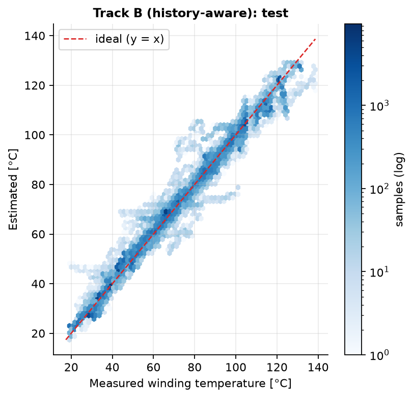
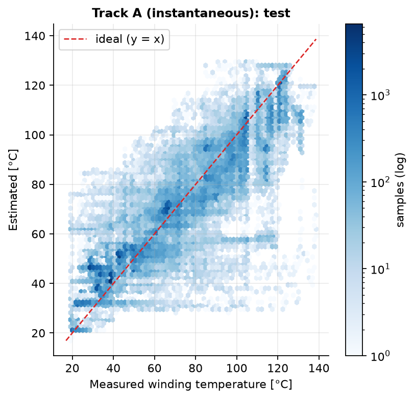
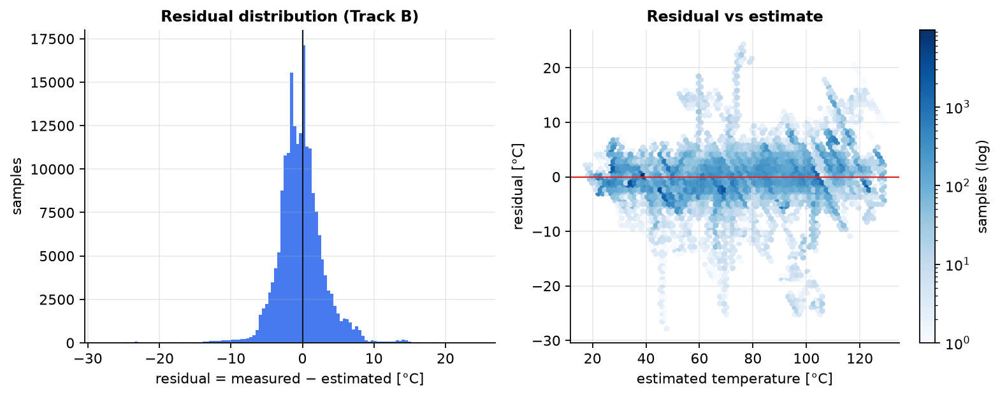
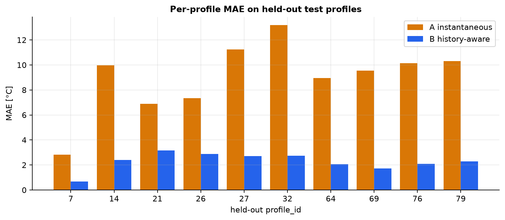
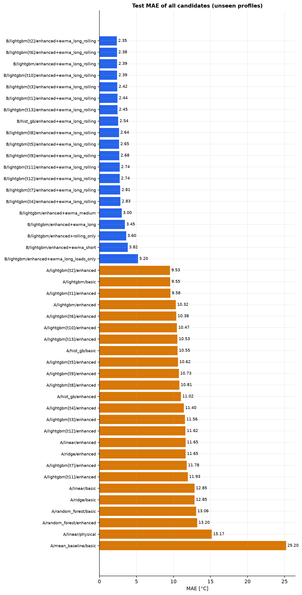

### 11.3 Did history help? (ablation, identical validation profiles)

| history set | features | val MAE (mean ± std over seeds) | val RMSE | worst-profile val MAE |
|---|---|---|---|---|
| none | 17 | 9.42 ± 0.06 | 12.91 | 13.56 |
| rolling_only | 25 | 3.74 ± 0.02 | 4.98 | 6.25 |
| ewma_short | 25 | 3.63 ± 0.10 | 5.32 | 5.59 |
| ewma_medium | 29 | 3.03 ± 0.11 | 4.51 | 4.66 |
| ewma_long_loads_only | 32 | 5.33 ± 0.14 | 8.15 | 10.61 |
| ewma_long | 37 | 3.95 ± 0.05 | 6.02 | 7.62 |
| ewma_long_rolling | 45 | 2.32 ± 0.08 | 3.57 | 3.60 |

On the validation profiles, every history set beats the instantaneous model (9.42 °C); the best set ('ewma_long_rolling') reaches 2.32 °C (± 0.08 across seeds). Differences between history sets are smaller than the gap to the instantaneous model, and the seed spread shows differences below ≈ 0.3 °C should not be over-interpreted. The step from `ewma_long_loads_only` to `ewma_long` shows the value of the coolant-temperature
history; the step to `ewma_long_rolling` shows the value of the short rolling windows. We did not isolate the
mechanism behind the latter and report it as an empirical finding. On the test profiles the same default-parameter
LightGBM configurations give:

| candidate | n_features | test MAE | RMSE | R² | profile-mean MAE |
|---|---|---|---|---|---|
| A/lightgbm/basic | 8 | 9.551 | 13.603 | 0.787 | 8.971 |
| A/lightgbm/enhanced | 17 | 10.318 | 14.106 | 0.771 | 9.819 |
| B/lightgbm/enhanced+rolling_only | 25 | 3.604 | 4.891 | 0.972 | 3.386 |
| B/lightgbm/enhanced+ewma_short | 25 | 3.819 | 5.991 | 0.959 | 3.712 |
| B/lightgbm/enhanced+ewma_medium | 29 | 3.001 | 5.368 | 0.967 | 2.879 |
| B/lightgbm/enhanced+ewma_long_loads_only | 32 | 5.204 | 7.910 | 0.928 | 4.791 |
| B/lightgbm/enhanced+ewma_long | 37 | 3.447 | 5.636 | 0.963 | 3.217 |
| B/lightgbm/enhanced+ewma_long_rolling | 45 | 2.390 | 3.742 | 0.984 | 2.208 |

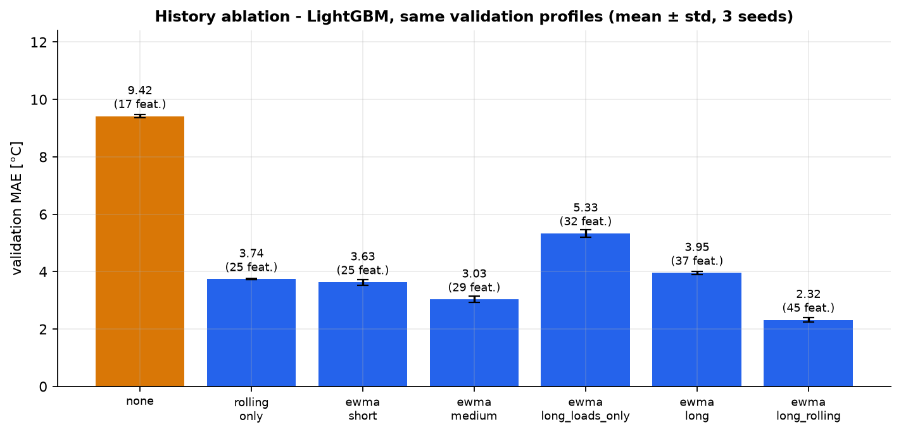

### 11.4 Where are the errors?

By measured winding-temperature range (test):

| measured range [°C] | samples | Track A MAE | Track B MAE | Track B p95 | Track B bias |
|---|---|---|---|---|---|
| (-0.001, 40.0] | 46,985 | 8.96 | 1.48 | 4.48 | 0.20 |
| (40.0, 60.0] | 36,377 | 8.04 | 2.76 | 5.85 | 1.83 |
| (60.0, 80.0] | 41,346 | 8.31 | 2.34 | 5.61 | 0.83 |
| (80.0, 100.0] | 32,944 | 10.72 | 2.53 | 6.02 | -0.04 |
| (100.0, 200.0] | 40,847 | 11.76 | 2.88 | 7.94 | -1.49 |

By operating region (speed × torque terciles taken from the training data), Track B:

| MAE [°C] | low torque | mid torque | high torque |
|---|---|---|---|
| low speed | 1.79 | 1.95 | 1.24 |
| mid speed | 1.70 | 2.62 | 2.52 |
| high speed | 2.47 | 2.52 | 3.35 |

*Tercile edges (training data): |speed| 796 / 3051 rpm, |torque| 15.2 / 82.7 N·m.*

By elapsed time within the profile (Track B) - the history buffer fills up over time:

| time in profile | samples | MAE [°C] |
|---|---|---|
| 0-10 min | 12010 | 5.91 |
| 10-30 min | 24000 | 2.45 |
| 30-60 min | 35049 | 1.88 |
| 1-2 h | 64800 | 2.13 |
| >2 h | 62640 | 2.13 |

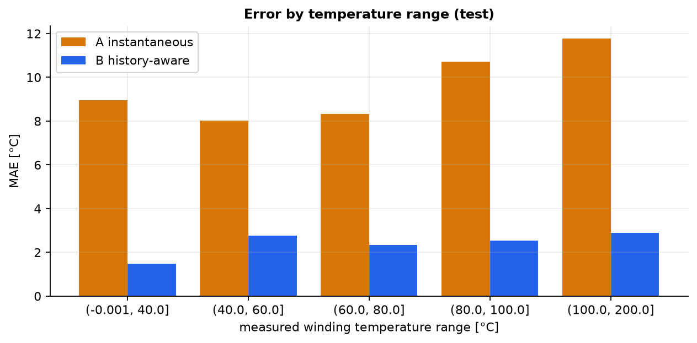

### 11.5 Difficult-profile case study

Worst test profile for Track B: **profile 21** (MAE 3.16 °C).

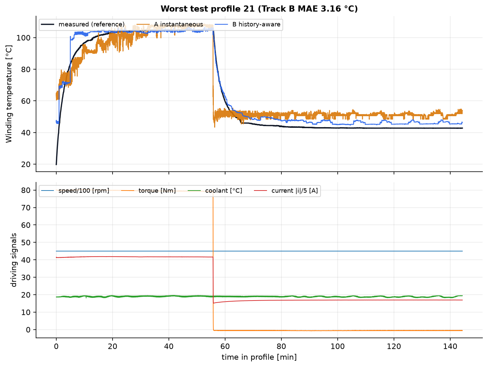
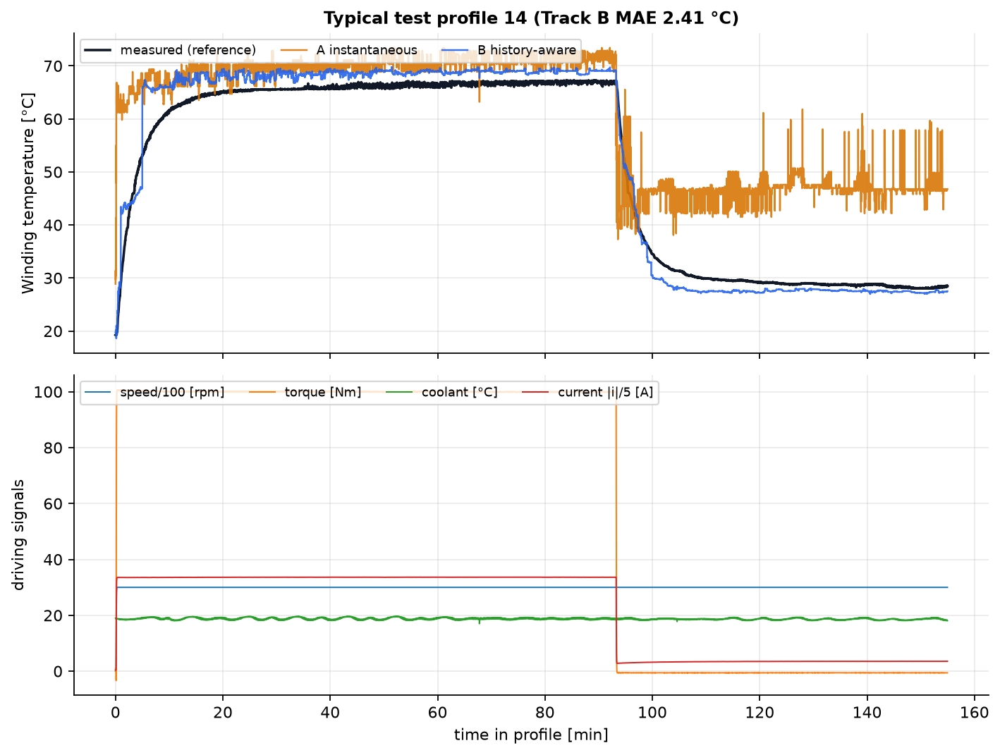

It lasts 2.4 h, starts at 20 °C and peaks at 105 °C (coolant mean 19 °C). The model under-estimates the hottest 10 % of the profile by 0.2 °C on average; the MAE is 10.2 °C in the first 10 min and 2.6 °C afterwards. The large early error is the cold-start phase: the 60 s / 300 s rolling windows are NaN at first and the estimate can jump when they become available (see the figure).

### 11.6 Robustness to a history-buffer restart

On 9 long test profiles the history buffer was emptied after 60 min (motor already warm) and rebuilt from that moment. MAE over the rest of those profiles: 2.13 °C with full history vs 2.98 °C after the restart; in the first 30 min after the restart 2.09 °C vs 5.38 °C.

### 11.7 Cost

| Model | Fit time | Size | Single-row latency | Batch throughput |
|---|---|---|---|---|
| Track A winner | 3.9 s | 109 kB | 1.7 ms | 317,018 rows/s |
| Track B winner | 31.7 s | 857 kB | 3.5 ms | 35,965 rows/s |

(Latency measured through the scikit-learn pipeline on this CPU, single-row call, dominated by pandas/pipeline overhead. The pure-Python streaming history update for Track B costs about 350 µs per sample.)

---

## 12. Explainability

Permutation importance on a 40,000-row **validation** sample (3 repeats): shuffle one feature
(or one family of correlated features) and measure the increase of MAE.

Track B, by feature family:

| group | n_features | MAE increase [°C] | ± std |
|---|---|---|---|
| load history (i², speed, torque) | 21 | 26.14 | 0.13 |
| coolant history | 7 | 17.58 | 0.00 |
| ambient / coolant now | 3 | 0.42 | 0.01 |
| currents / voltages now | 7 | 0.18 | 0.00 |
| speed / torque now | 4 | 0.06 | 0.00 |
| power & loss proxies | 3 | 0.05 | 0.00 |

Track B, top individual features:

| feature | group | MAE increase [°C] | ± std |
|---|---|---|---|
| ewm_i_sq_120s | load history (i², speed, torque) | 10.05 | 0.01 |
| ewm_coolant_600s | coolant history | 6.97 | 0.02 |
| roll_i_sq_300s | load history (i², speed, torque) | 6.58 | 0.03 |
| roll_coolant_300s | coolant history | 5.68 | 0.02 |
| ewm_i_sq_600s | load history (i², speed, torque) | 5.10 | 0.03 |
| ewm_coolant_120s | coolant history | 2.43 | 0.02 |
| ewm_abs_speed_600s | load history (i², speed, torque) | 1.78 | 0.01 |
| ewm_abs_speed_120s | load history (i², speed, torque) | 1.60 | 0.01 |
| roll_i_sq_60s | load history (i², speed, torque) | 0.55 | 0.01 |
| roll_abs_speed_300s | load history (i², speed, torque) | 0.53 | 0.00 |

Track A, by feature family:

| group | n_features | MAE increase [°C] | ± std |
|---|---|---|---|
| ambient / coolant now | 3 | 13.34 | 0.02 |
| currents / voltages now | 7 | 13.03 | 0.11 |
| power & loss proxies | 3 | 3.64 | 0.01 |
| speed / torque now | 4 | 1.70 | 0.01 |

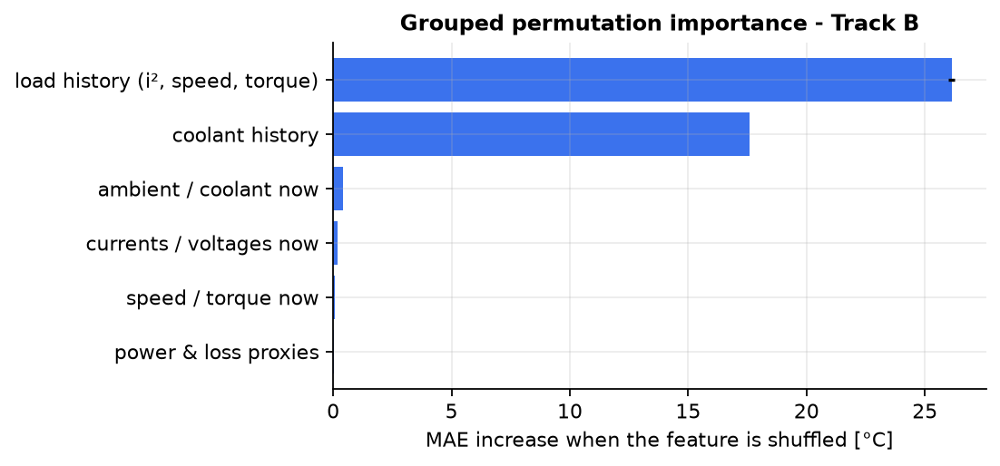
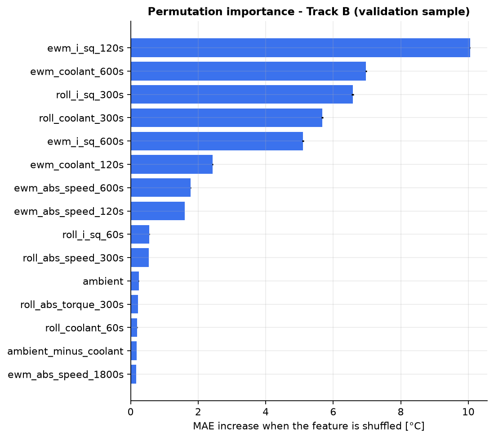

**Interpretation and caveats.** For Track B the largest increases come from the families 'load history (i², speed, torque)' (+26.1 °C) and 'coolant history' (+17.6 °C), whereas the present-moment families add comparatively little - the history features carry the information. Many features are strongly correlated (e.g. $i^2$, $|i|$ and the power
proxies; EWMAs at neighbouring time constants), so single-feature importances understate each member of a
correlated group - hence the grouped view. Permutation importance describes what *this model uses to predict*; it does
not establish physical causation. Both the importance of the coolant history and the ordering of time constants are
properties of this test bench, where the coolant temperature is set by the operator.

---

## 13. Thermal residual monitoring (experimental)

$$\text{residual}_t = y^{measured}_t - \hat y_t \quad(\text{Track B}),\qquad \bar r_t=\text{causal rolling mean over }60\text{ s}$$

The band is the 99.5th percentile of $|\bar r|$ on the **validation** profiles: **±10.8 °C**. An alarm
is raised when $|\bar r|$ stays outside the band for ≥ 120 s, so isolated noisy samples do not trigger it.

| Healthy held-out data | Validation (calibration) | Test |
|---|---|---|
| samples outside band (raw residual) | 0.50 % | 1.23 % |
| samples outside band (smoothed) | 0.50 % | 1.16 % |
| time in persistent alarm | 0.01 % | 0.13 % |
| profiles with ≥ 1 alarm | 1 / 10 | 2 / 10 |
| alarm events per hour | 0.03 | 0.07 |

All alarms on this data are false alarms or ordinary model error (the profiles are healthy recordings), so the
transfer of the band from validation to test is the honest indicator of its reliability: the persistent-alarm time is 0.01 % on validation and 0.13 % on test (20x the validation value, though small in absolute terms), and 2 of 10 test profiles raise at least one alarm.

**Synthetic sensitivity illustration** (a constant offset added to the measured test temperatures; *not* real faults):

| injected offset [°C] | profiles alarming | of which newly (not alarming without offset) | median first alarm [min] | time in alarm [%] |
|---|---|---|---|---|
| 2.00 | 3 / 10 | 2 | 16 | 0.2 |
| 5.00 | 4 / 10 | 3 | 17 | 2.7 |
| 10.00 | 9 / 10 | 7 | 26 | 20.6 |
| 15.00 | 10 / 10 | 8 | 4 | 87.9 |

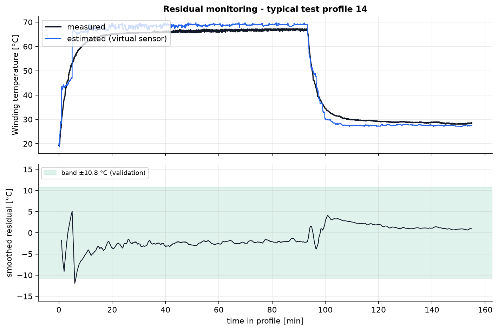
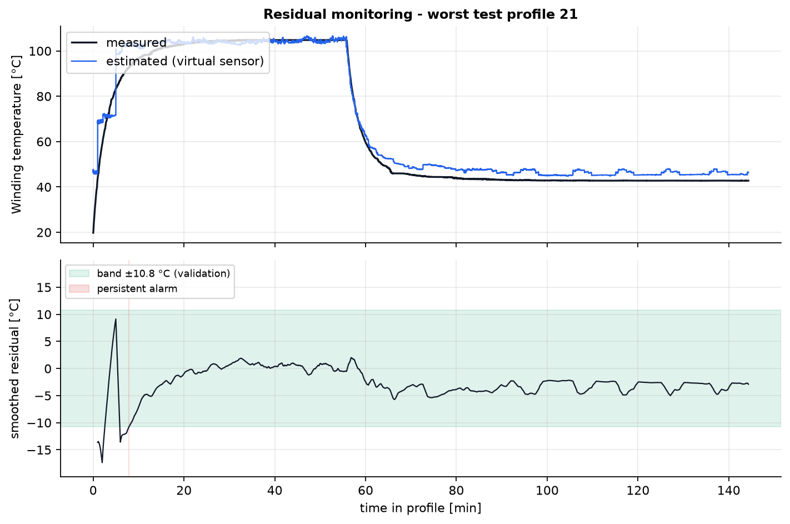

**What this is not.** The method flags *disagreement between a sensor and a model*. It cannot say whether the
cause is a sensor fault, a cooling change, an unseen operating point, model error, or a motor defect, and no
independently labelled fault data exist, so **no fault-detection accuracy is claimed**. The empirical band is not a
probabilistic guarantee, and this software is not a certified protection system.

---

## 14. Engineering limitations and future extensions

**Limitations.**

1. *Single motor / test bench.* Results do not transfer to other machines without retraining and validation.
2. *Extrapolation.* Tree models cannot extrapolate; the app warns when inputs leave the training range.
3. *Cold and warm starts.* History features need a filled buffer: Track B's error is 5.91 °C in the first 10 min of a profile versus 2.13 °C after 2 h (the rolling windows are NaN for the first 5 min and the estimate can jump when they become available - visible in the case study). Emptying the buffer on a warm motor raised the MAE in the next 30 min from 2.09 to 5.38 °C.
4. *Operator-controlled coolant.* The usefulness of coolant history may differ in a real installation.
5. *Validation size.* Group-CV standard deviation (0.25 °C for Track B) shows that results depend on
   which profiles are held out; 10 test profiles are a small sample of operating behaviour.
6. *Assumed units/sampling.* Units and 2 Hz are not recorded in the file.
7. *Early stopping on validation* makes validation scores slightly optimistic; the test scores are not affected.
8. *Sensor uncertainty.* The reference measurement itself has unknown uncertainty.

**Future work.** Sequence models for comparison; state initialisation from the first minutes of a profile; uncertainty
estimates (quantile regression or conformal intervals); online adaptation; validation on labelled fault data; a
hybrid physics + ML model that learns the lumped thermal parameters.

### 14.1 Extension: forecasting winding temperature 60 s ahead

Target: the winding temperature 60 s later (shifted within each profile; the last 60 s of every profile have no label and are dropped), causal features only - no future current, speed, torque, coolant or temperature. F1 uses the Track B features; F2 additionally uses the *measured* winding temperature at time t and its change over the last horizon (needs the physical sensor). Persistence MAE: 2.66 °C. The sensor-independent forecast F1 (3.24 °C) does not beat persistence (2.66 °C) on MAE; its RMSE is 4.52 °C vs 4.77 °C for persistence (better on large errors). The sensor-assisted forecast F2 (2.27 °C) beats persistence, which shows how valuable the present measured state is. The Track B estimator, which targets the *current* temperature, is not a forecaster (MAE 3.85 °C against the future value). This extension is a small, separate experiment on the same held-out test profiles, with no tuning on them.

| method | MAE [°C] | RMSE [°C] | R² | worst-profile MAE |
|---|---|---|---|---|
| persistence T(t) | 2.662 | 4.771 | 0.974 | 4.963 |
| Track B estimate used as forecast (wrong tool) | 3.852 | 5.449 | 0.966 | 5.227 |
| F1 - forecast model without winding sensor | 3.235 | 4.522 | 0.976 | 4.271 |
| F2 - forecast model with measured T(t) and its change | 2.267 | 3.285 | 0.987 | 3.874 |

---

## 15. Conclusion and references

On 10 unseen test profiles the history-aware virtual sensor reaches MAE 2.35 °C (RMSE 3.37 °C, R² 0.987, 95 % of errors below 6.4 °C) versus 9.53 °C for the best instantaneous model - 4.0× lower error.

* History is the dominant factor: the best instantaneous model is limited to ≈ 9.53 °C MAE no matter which algorithm is
  used, whereas representing thermal inertia brings it to ≈ 2.35 °C.
* Evaluation on whole held-out profiles, with leakage guards covered by tests, gives results that can be trusted more than a
  random row split would have.
* The residual monitor is a demonstration, not a fault detector.

**References**

1. W. Kirchgässner, O. Wallscheid, J. Böcker, *Electric Motor Temperature* dataset, Paderborn University LEA, Kaggle
   (CC BY-SA 4.0), <https://www.kaggle.com/datasets/wkirgsn/electric-motor-temperature>.
2. W. Kirchgässner, O. Wallscheid, J. Böcker, "Estimating electric motor temperatures with deep residual machine learning",
   *IEEE Trans. Power Electronics*, 2021; reference code <https://github.com/upb-lea/deep-pmsm>.
3. G. Ke et al., "LightGBM: A highly efficient gradient boosting decision tree", *NIPS* 2017; <https://lightgbm.readthedocs.io/>.
4. scikit-learn documentation: *Cross-validation* <https://scikit-learn.org/stable/modules/cross_validation.html>, *Common pitfalls*
   <https://scikit-learn.org/stable/common_pitfalls.html>.
5. P. Mellor, D. Roberts, D. Turner, "Lumped parameter thermal model for electrical machines of TEFC design", *IEE Proc. B*, 1991.

*Reproduce:* see `README.md` and `scripts/run_pipeline.sh`.
